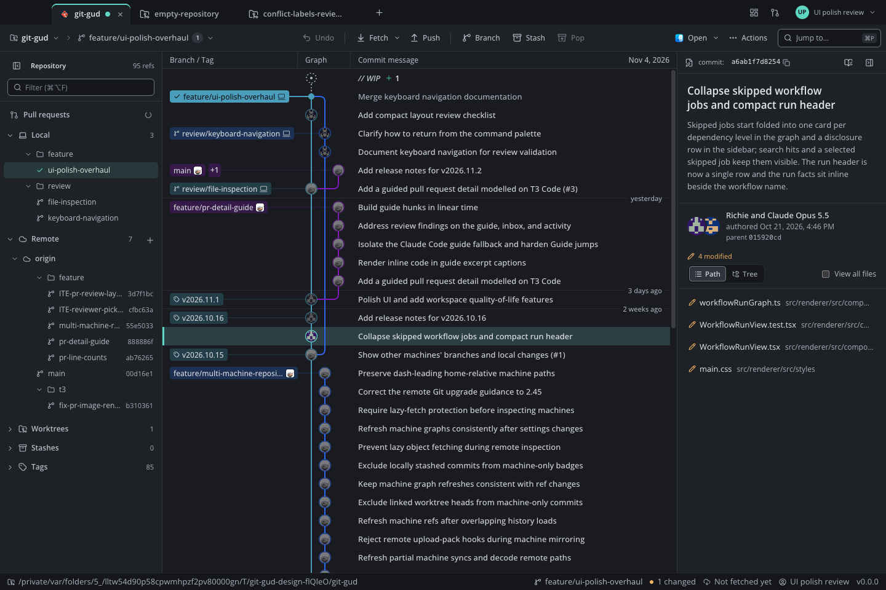
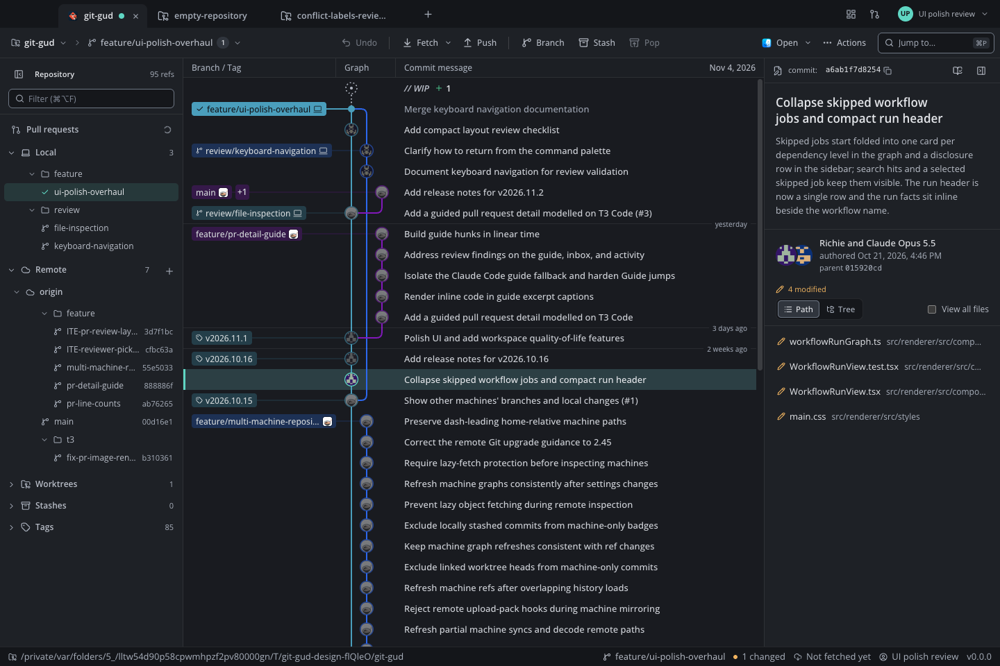

# Matched screenshot comparison

These eight pairs compare the round-6 application with the round-11 application at the same viewport and 1× capture density. Each PNG is an unchanged capture of the running Electron app. The compact working copy uses 1100×760; the other seven use 1440×960. No screenshots were reconstructed or resampled.

The dates, counts, workflow runs and PR diff content differ between capture dates. Judge layout, visual hierarchy, spacing and legibility with those differences in mind. This is not a controlled usability experiment. Screenshot design and app-wide readiness are separate judgments.

| View | Round 6 | Round 11 |
| --- | --- | --- |
| History | [History](images/ui-polish-overhaul/comparison-round-6/history.png) | [History](https://raw.githubusercontent.com/Kaldy14/git-gud/9bae339/docs/images/ui-polish-overhaul/history.png) |
| Diff | [Diff](images/ui-polish-overhaul/comparison-round-6/diff.png) | [Diff](https://raw.githubusercontent.com/Kaldy14/git-gud/9bae339/docs/images/ui-polish-overhaul/diff.png) |
| Working copy compact | [Working copy compact](images/ui-polish-overhaul/comparison-round-6/working-copy-compact.png) | [Working copy compact](https://raw.githubusercontent.com/Kaldy14/git-gud/9bae339/docs/images/ui-polish-overhaul/working-copy-compact.png) |
| Start | [Start](images/ui-polish-overhaul/comparison-round-6/start.png) | [Start](https://raw.githubusercontent.com/Kaldy14/git-gud/9bae339/docs/images/ui-polish-overhaul/start.png) |
| Palette | [Palette](images/ui-polish-overhaul/comparison-round-6/palette.png) | [Palette](https://raw.githubusercontent.com/Kaldy14/git-gud/9bae339/docs/images/ui-polish-overhaul/palette.png) |
| Settings | [Settings](images/ui-polish-overhaul/comparison-round-6/settings.png) | [Settings](https://raw.githubusercontent.com/Kaldy14/git-gud/9bae339/docs/images/ui-polish-overhaul/settings.png) |
| Pr code | [Pr code](images/ui-polish-overhaul/comparison-round-6/pr-code.png) | [Pr code](https://raw.githubusercontent.com/Kaldy14/git-gud/9bae339/docs/images/ui-polish-overhaul/pr-code.png) |
| Dashboard | [Dashboard](images/ui-polish-overhaul/comparison-round-6/dashboard.png) | [Dashboard](https://raw.githubusercontent.com/Kaldy14/git-gud/9bae339/docs/images/ui-polish-overhaul/dashboard.png) |

Round 6 was captured from `f5eb1ab`. Round-11 captures are fixed at `9bae339` and include the small follow-up corrections to `eb33dfe`. The round-11 compact workspace uses the navigation rail and the PR workspace uses the shorter shared header. Wide history retains the earlier graphite palette and type scale.

Validation details and remaining limits are in [UI polish validation](ui-polish-validation.md).
