# UI polish validation

These are unmodified screenshots of the running Git Gud Electron application. They show real Git history, local staging, an empty repository, a failed local clone, and read-only views of GitHub PR #4 and its workflow runs. Settings and repositories used for validation are isolated from the normal desktop workspace.

## Inbox badge follow-up

The round-11 review found an empty pill in the docked Pull requests row when no count was available. The badge now renders only for a known count; a genuine zero remains visible. Seven focused sidebar tests, scoped ESLint and the build including typecheck pass. Three actual-app checks verify the unavailable docked row, unavailable flyout row and recovered real count. The controlled local IPC failure uses the same isolated profile as the prior pass. No renderer or console errors were recorded.

[Docked unavailable row](images/ui-polish-overhaul/inbox-unavailable-docked.png), [flyout unavailable row](images/ui-polish-overhaul/inbox-unavailable-flyout.png), and [recovered count](images/ui-polish-overhaul/inbox-recovered-docked.png).

```sh
pnpm exec vitest run src/renderer/src/components/sidebar/Sidebar.test.tsx
pnpm exec eslint src/renderer/src/components/sidebar/Sidebar.tsx src/renderer/src/components/sidebar/Sidebar.test.tsx
pnpm build
node /tmp/git-gud-polish-inbox-badge-r12.mjs
```

## Latest focused pass

Round 11 keeps the existing visual direction and compares eight fixed views with round 6 at matching dimensions and 1× density. [Open the matched comparison](ui-polish-comparison.md). The eight current comparison images, working-copy image, selected-code images and short-footer images in this gallery are from this pass. Other gallery images retain their earlier provenance. The Retina set below is from round 10.

`pnpm lint`, `pnpm build` including typecheck, and `pnpm exec vitest run src/renderer` pass. The renderer run has 97 files and 630 passing tests. `TMPDIR=/private/tmp pnpm test` also passes on this source, with 172 files, 1,365 passing tests and 4 skipped.

The actual Electron renderer at the URL below passes 21 core checks and 17 integration checks. Three additional stability checks distinguish an unavailable inbox from an empty one, restore the real count after recovery, and hold/release real full-file context with the first code row remaining at y194. The unavailable-inbox case deliberately rejects a local QA IPC request; it is not evidence of a real GitHub outage or a fabricated GitHub response.

A real selected import row retains 11.91:1 keyword/string contrast. Its teal edge now sits inside the number cell, ending before the code, so it does not cover the addition/deletion sign. The short PR footer is 104px tall when closed. With its explanation open at an effective 720×330 viewport, the footer is capped at 134px inside a 193px navigation pane, scrolls to its final action, and leaves 22px for the block list. Explanation metadata uses 11px. The compact commit option reads “Amend last commit” on one line.

Focused commands for this pass:

```sh
agent-browser --session git-gud-polish connect 9236
node /tmp/git-gud-polish-stability-r11.mjs
node /tmp/git-gud-polish-e2e-v11.mjs
node /tmp/git-gud-polish-broad-r11.mjs
node /tmp/git-gud-polish-selected-code-r11.mjs
```

[Unavailable inbox](images/ui-polish-overhaul/inbox-unavailable.png), [before context](images/ui-polish-overhaul/pr-before-context.png), [after context](images/ui-polish-overhaul/pr-after-context.png), [expanded short footer](images/ui-polish-overhaul/pr-explanation-short.png), and [its reachable final action](images/ui-polish-overhaul/pr-explanation-short-scrolled.png) are actual app captures. Reports and retained scripts are under `artifacts/ui-polish/round-11/`. No unexpected renderer or console errors were recorded. Browser network capture does not cover IPC or CLI traffic. Screen readers, other OS chrome, populated Guide output and remote write actions remain untested.

## Earlier full matrix and Retina captures

## Representative screenshot set

These seven captures come directly from the same running Electron build at device scale factor 2 and zoom 1. They are native 2880×1920 or 2200×1520 PNGs at unchanged 1440×960 or 1100×760 CSS viewports. Electron's `--force-device-scale-factor=2` enables the Retina-density run. They are not enlarged or resampled images. The complete 1× validation matrix remains linked below, including edge and error states.

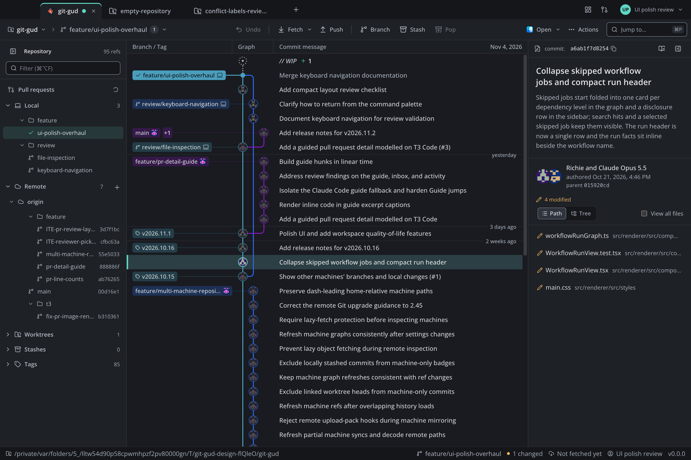

[Diff](images/ui-polish-overhaul/diff@2x.png), [compact working copy](images/ui-polish-overhaul/working-copy-compact@2x.png), [repository launcher](images/ui-polish-overhaul/start@2x.png), [compact PR Code](images/ui-polish-overhaul/pr-code-compact@2x.png), [local PR draft](images/ui-polish-overhaul/pr-comment-compact@2x.png), and [workflow dashboard](images/ui-polish-overhaul/dashboard@2x.png).

## Checks

| Command | Result |
| --- | --- |
| `pnpm typecheck` | Pass |
| `pnpm lint` | Pass |
| `TMPDIR=/private/tmp pnpm test` | 172 files, 1,364 tests passed, 4 skipped |
| `pnpm build` | Pass |
| `agent-browser --session git-gud-polish connect 9236` | Connected to the actual Electron renderer |

Focused validation at 1440×960 and 1100×760 passes 21 core checks, including history, file diffs, staging and unstaging a real file, settings, palette results and search scope, invalid clone/create forms, stash eligibility, and the empty-repository branch guard.

Keyboard resizing preserves a preferred 266px graph width at 1100px with the navigation rail. At 850px with details open it fits to 150px, and widening restores 266px. The stored preference stays unchanged. Double-click resets automatic lane sizing. Inactive avatars recede to 0.42 opacity, and hover restores full emphasis; arrow keys change the palette selection, and Escape restores focus to Jump. Compact ref names reveal in full on hover. The stash checkbox keeps exactly the same position when inclusion changes.

Seventeen integration checks load the actual PR Code view, open and cancel a file comment composer, save a local Actions dashboard, and display its workflow graph. A clone from a missing local source fails with Git exit 128, keeps the entered values, and can be retried. The error summary expands to the exact Git output. A separate disposable repository has a real merge conflict between `hotfix/login` and `feature/login`; branch creation is disabled and the resolver exposes distinct A/B choices without saving a resolution. The completed release graph shows the actual dependency diamond: Verify release feeds both builds, and Publish waits for both. Expanded matrix job names retain their dependencies. Four SVG edges and the corresponding runtime job IDs are checked, along with card fit at both window sizes. Names render at 13px and durations at 12px. Both file and line comment drafts survive Escape and V when focus moves outside the textarea. The labelled gutter button opens a line composer beneath its selected diff line, and new line targets stay unavailable until that composer closes. Validation types into both composers and explicitly cancels without submitting. The PR comment composer clearly states that drafts remain local until review submission. Viewed & next and other block navigation stay disabled during composition, with visibly dimmed unavailable rows.

No unexpected renderer exceptions or console errors were recorded. The browser network log contains no captured requests, so it does not establish coverage of GitHub IPC or CLI traffic. The expected Git failures above are part of the validation. Reports, exact local commands, and validation scripts remain in the ignored `artifacts/ui-polish/round-10/` folder in the task workspace.

The final readability pass uses 13px commit subjects in 30px graph rows, 13px diff code with 21px line spacing, and 12px settings helpers. Dashboard run outcomes sit beside their titles, with one timestamp in the same group. In-progress CI uses info blue.

Sidebar trees below 240px hide hash metadata while keeping complete branch names and hashes in row tooltips. Wider trees restore hashes. Below 1240px a 36px navigation rail opens a floating sidebar without moving the graph. Compact history and diff detail choices are separate session state and leave saved panel preferences untouched. Grouped workflow outcomes follow their names. Selected PR tabs keep teal while hovered. Queued workflow timestamps say Queued, and waiting jobs show no execution duration.

Muted metadata now uses `#a8afbb`, measuring 5.0:1 against the selected graph row, up from 4.3:1. The palette footer and PR navigation hints are easier to read. Pending context-loading text stays info blue at compact widths. The PR-grouped Actions tile uses at least 11px content text.

Nine line-comment checks verify the labelled action, UI typography, line placement, keyboard draft protection, compact fit and explicit cancellation. Five additional coverage checks verify compact diff, palette, PR Code, and grouped dashboard layouts. Summary, Guide, and Activity captures explicitly select their corresponding real panes. The Guide capture shows its initial empty state; no generation was invoked. Completed CI states are captured from real GitHub runs. The linked prior running sample is round 8, run 41889943591; the linked queued samples are round 7. These prior captures do not certify this pass’s title-strip layout or newly sampled queued jobs. Any new live sample is recorded separately. Those prior queued rows identify waiting time, and both waiting job cards show a dash instead of execution time.


Sixteen compact-workspace checks and nine flyout interaction checks cover outside dismissal, Escape priority, dialog layering, keyboard focus, folder and filter retention, visible Solo filtering, Start navigation, and both open and collapsed saved preferences. The compact graph canvas measures 778px at 1100px. Seven additional checks delay the real full-file GitHub response without changing its payload, collapse a file, type at a middle caret in another block, release context, and verify both the collapsed state and the same editor node, selection, focus and insertion point. Full context becomes available after cancellation. The gutter button and painted line number have separate, nonoverlapping bounds. Diff selection now uses teal.


The shared PR header now ends at y137 on both tall and compact desktops, compared with y202 before this refinement. All four tabs share this content edge. Seven header checks cover compact, short wide, 850px and native 200% views. The metadata condenses while scrolling Activity and returns at the top. Eleven appearance checks verify the neutral annotation gutter, a teal input focus border and outline, 5.37:1 selected-line-number contrast, overflow fades, horizontal strip scrolling and real keyboard tab activation. Selector-based scrolling was used because this agent-browser version routes the low-level wheel command to coordinate 0,0; physical wheel routing is not certified.

A delayed real inbox response verifies that both the rail and title-bar control announce loading, reserve an unknown count, and change to the real count of two. The ref-hover check proves clipping at rest, 171px available for 201px of text, before revealing the full 201px. Four extra compact checks cover clone/create forms, stash and both conflict source choices without submitting or saving a resolution.


Selected code retains addition/deletion backgrounds and inline change emphasis, carries a thin teal edge, and temporarily uses one readable foreground. An actual selected import row with keyword and string-literal tokens measures 11.91:1 against its row background; an added type/keyword row measures 11.36:1. This fixes the contrast loss caused by tinting syntax-coloured text. Normal syntax colors return when selection clears. The number remains at 5.37:1. This does not certify every unselected token in every syntax theme.

The active repository tab is now revealed after strip resize as well as activation. The zoom check asserts its entire bounds, not just fade flags: New Tab spans x338.5–456.5 inside the scroller at x84–458.66 after zoom. Inactive hover remains distinct from its selected neighbour's teal edge. At a 480px CSS height the PR footer and content are both 104px high, with no overflow scrollbar. A matching open-panel icon replaces the sidebar's filled chevron; aggregate Healthy text recedes while individual run outcomes retain their status colours.

Tested renderer URL: `file:///Volumes/DevSSD/worktrees/git-gud/t3-8b4af8c3/out/renderer/index.html`.

Focused commands:

```sh
agent-browser --session git-gud-polish connect 9236
node /tmp/git-gud-polish-e2e-v10.mjs
node /tmp/git-gud-polish-layout-check-v10.mjs
node /tmp/git-gud-polish-broad-r10.mjs
node /tmp/git-gud-polish-interaction-r10.mjs
node /tmp/git-gud-polish-ref-hover-r10.mjs
node /tmp/git-gud-polish-release-r10.mjs
node /tmp/git-gud-polish-coverage-r10.mjs
node /tmp/git-gud-polish-line-comment-r10.mjs
node /tmp/git-gud-polish-context-r10.mjs
node /tmp/git-gud-polish-compact-r10.mjs
node /tmp/git-gud-polish-flyout-r10.mjs
node /tmp/git-gud-polish-header-r10.mjs
node /tmp/git-gud-polish-appearance-r10.mjs
node /tmp/git-gud-polish-loading-r10.mjs
node /tmp/git-gud-polish-extra-compact-r10.mjs
node /tmp/git-gud-polish-selected-code-r10.mjs
node /tmp/git-gud-polish-retina-r10.mjs
```

Script copies and machine-readable reports are retained with the local screenshots.

## Screenshots

### History

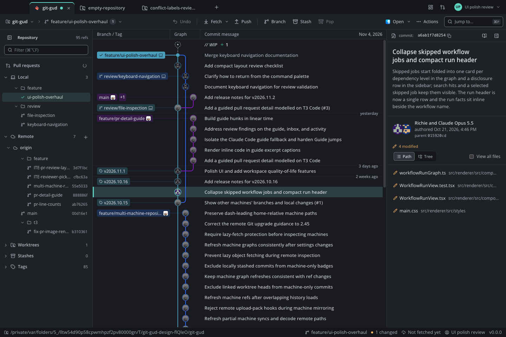

### Diff

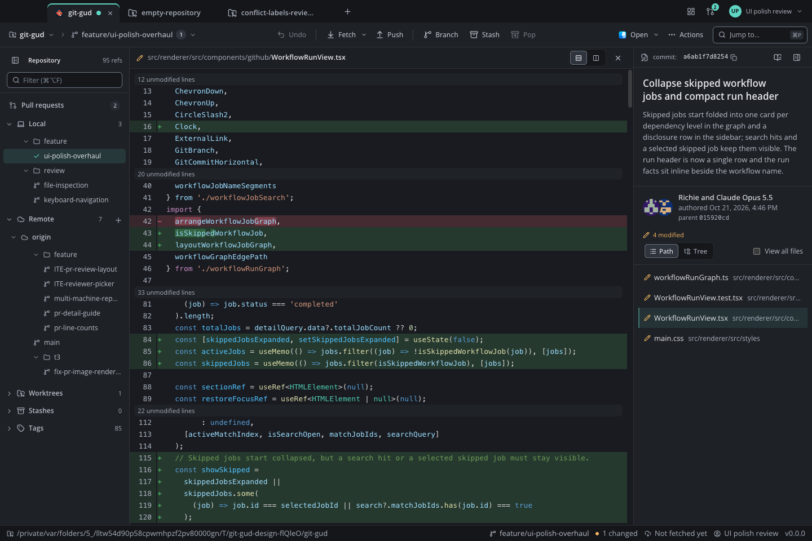

### Compact staging

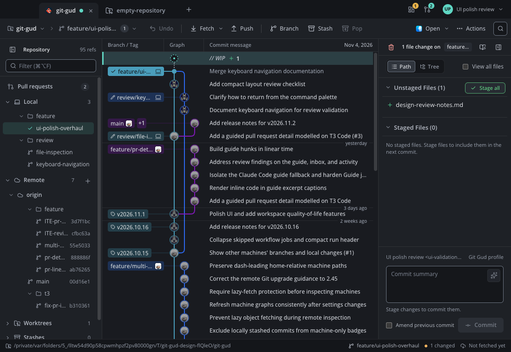

### Repositories

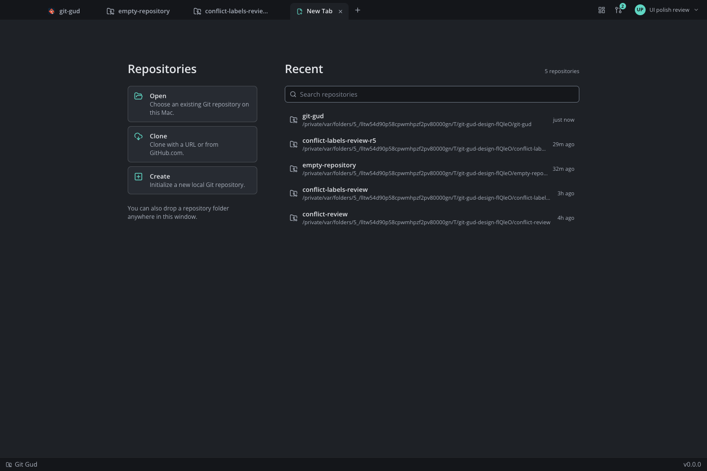

### Command palette

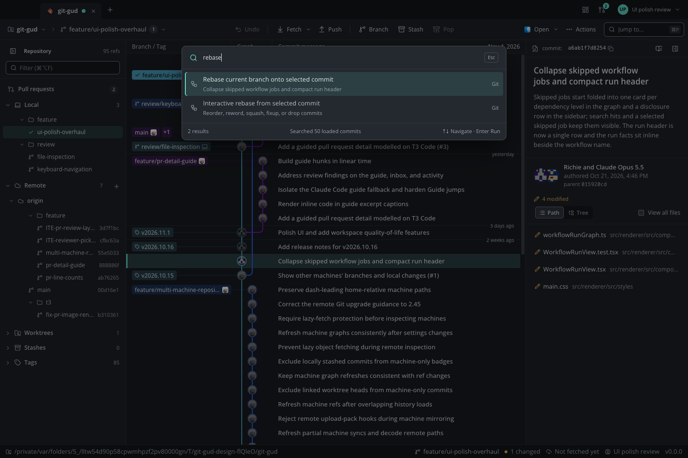

### Error recovery

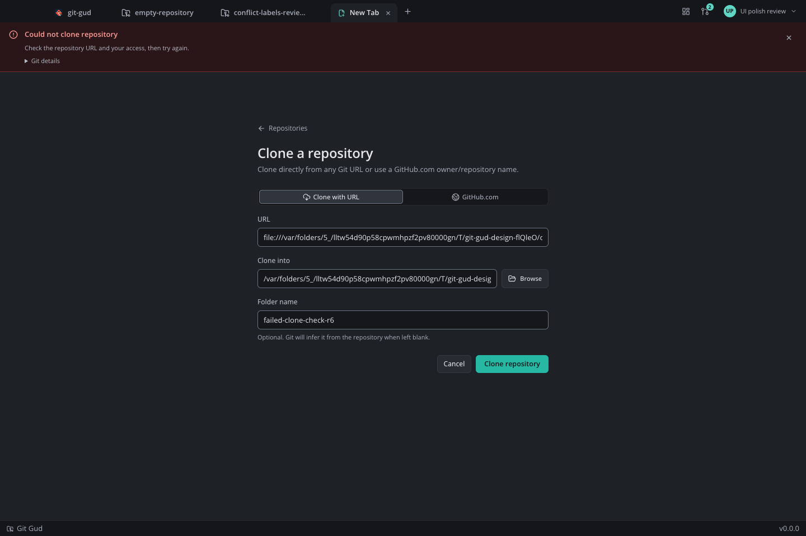

Other verified states: [settings](images/ui-polish-overhaul/settings.png), [stash](images/ui-polish-overhaul/stash.png), [PR Code](images/ui-polish-overhaul/pr-code.png), [Actions dashboard](images/ui-polish-overhaul/dashboard.png), [release job graph](images/ui-polish-overhaul/workflow-release.png), [local PR draft composer](images/ui-polish-overhaul/pr-comment-draft.png), and [conflict resolver](images/ui-polish-overhaul/conflict-resolver.png).

Additional coverage: [PR Summary](images/ui-polish-overhaul/pr-summary.png), [Guide empty state](images/ui-polish-overhaul/pr-guide.png), [Activity](images/ui-polish-overhaul/pr-activity.png), [PR-grouped Actions](images/ui-polish-overhaul/dashboard-pull-requests.png), [compact diff](images/ui-polish-overhaul/diff-compact.png), [compact palette](images/ui-polish-overhaul/palette-compact.png), [compact PR Code](images/ui-polish-overhaul/pr-code-compact.png), [prior round-7 queued dashboard](images/ui-polish-overhaul/dashboard-queued.png), [prior round-7 queued CI jobs](images/ui-polish-overhaul/workflow-queued.png), [prior round-8 running dashboard](images/ui-polish-overhaul/dashboard-running.png), [prior round-8 running CI jobs](images/ui-polish-overhaul/workflow-running.png), and [compact release graph](images/ui-polish-overhaul/workflow-release-compact.png).

[Accessible line-comment action](images/ui-polish-overhaul/pr-line-comment-affordance.png) and [protected line draft](images/ui-polish-overhaul/pr-line-comment-draft.png), and [compact line draft](images/ui-polish-overhaul/pr-line-comment-compact.png) are also captured from the running app.

### Adaptive workspace

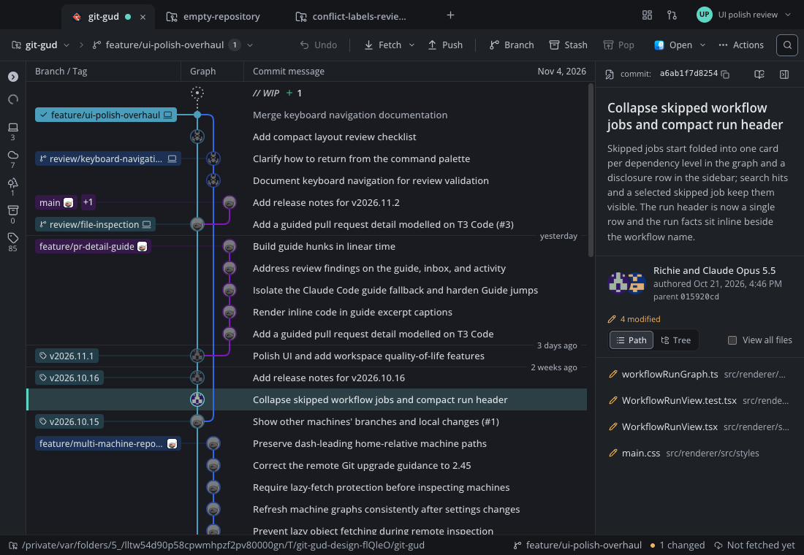

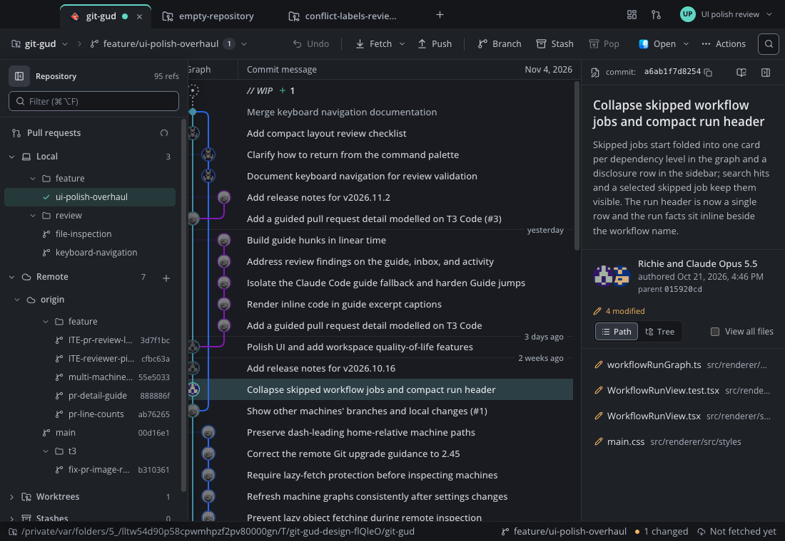

[Expanded compact diff](images/ui-polish-overhaul/diff-compact-expanded.png), [native 200% history zoom](images/ui-polish-overhaul/history-zoom-200.png), and [retained editor during real context arrival](images/ui-polish-overhaul/pr-context-arrival-draft.png).

### Compact PR review and focus

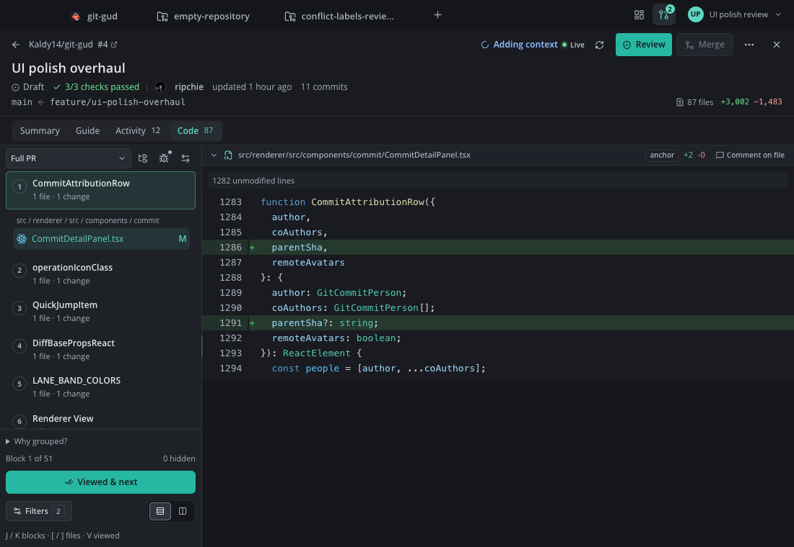

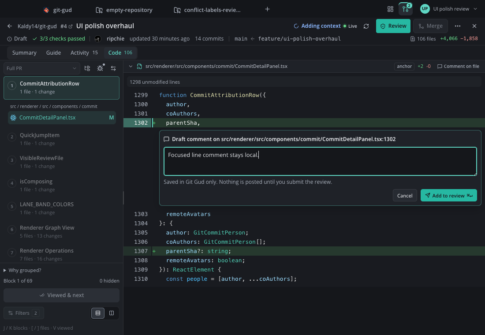

[Compact Summary](images/ui-polish-overhaul/pr-summary-compact.png), [compact Activity](images/ui-polish-overhaul/pr-activity-compact.png), [PR Code at native 200% zoom](images/ui-polish-overhaul/pr-code-zoom-200.png), [overflowing tabs](images/ui-polish-overhaul/tabs-overflow-zoom-200.png), [unknown loading count](images/ui-polish-overhaul/sidebar-rail-loading.png), [compact clone](images/ui-polish-overhaul/clone-compact.png), and [compact conflict resolver](images/ui-polish-overhaul/conflict-resolver-compact.png).

[Selected keyword and string row](images/ui-polish-overhaul/pr-selected-keyword-string.png), [short footer at native 200% zoom](images/ui-polish-overhaul/pr-code-short-footer-zoom-200.png), and [hovered versus selected tabs](images/ui-polish-overhaul/tabs-hover-distinction-zoom-200.png) are also retained.

## Scope and limits

The runtime checks use macOS. Linux and Windows CI also run the repository checks, but this does not establish visual parity of platform window chrome. No authenticated push, merge, review submission, workflow rerun, or conflict resolution was executed in the application. Screen-reader traversal remains untested. Native 200% zoom was checked for history, sidebar, PR Code and tab overflow at an effective width of 720 CSS pixels; other flows at that zoom were not audited.

Plain file diffs cannot expand unchanged context absent from their patches. Existing graph-column preferences reset once to automatic sizing under the new storage key; subsequent preferred widths survive window resizing. Below 1240px navigation moves to a rail; below 900px details also start as a rail. Widening restores saved preferences.

On this Mac, the full suite uses the canonical `/private/tmp` directory because an existing Pi shell test compares `/var` and `/private/var` paths literally. Its first run with the noncanonical temporary path failed that assertion; the canonical-path run passes without modifying the test.
